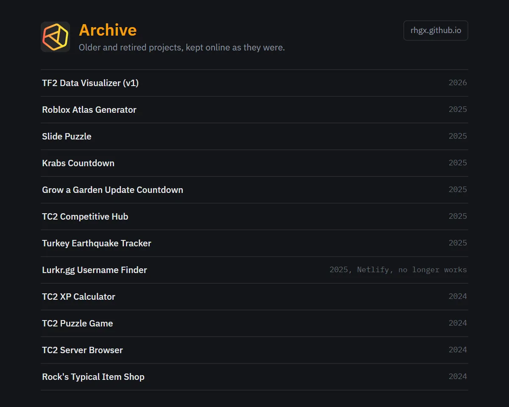

#  Archive

My older and retired projects, kept online as they were.

**[Open the archive](https://rhgx.github.io/archives/)**

## Projects

| Project | Year | Folder |
| --- | --- | --- |
| [TF2 Data Visualizer (v1)](https://rhgx.github.io/archives/tf2-data-visualizer-v1/) | 2026 | `tf2-data-visualizer-v1/` |
| [Roblox Atlas Generator](https://rhgx.github.io/archives/video-to-atlas/) | 2025 | `video-to-atlas/` |
| [Slide Puzzle](https://rhgx.github.io/archives/slider/) | 2025 | `slider/` |
| [Krabs Countdown](https://rhgx.github.io/archives/krabs-countdown/) | 2025 | `krabs-countdown/` |
| [Grow a Garden Update Countdown](https://rhgx.github.io/archives/gag-countdown/) | 2025 | `gag-countdown/` |
| [TC2 Competitive Hub](https://rhgx.github.io/archives/tc2-comp-hub/) | 2025 | `tc2-comp-hub/` |
| [Turkey Earthquake Tracker](https://rhgx.github.io/archives/turkey-earthquake-map/) | 2025 | `turkey-earthquake-map/` |
| [Lurkr.gg Username Finder](https://starlit-shortbread-ca47d4.netlify.app/) | 2025 | Hosted on Netlify; no longer works |
| [TC2 XP Calculator](https://rhgx.github.io/archives/tc2-xp-calc/) | 2024 | `tc2-xp-calc/` |
| [TC2 Puzzle Game](https://rhgx.github.io/archives/tc2-puzzle/) | 2024 | `tc2-puzzle/` |
| [TC2 Server Browser](https://rhgx.github.io/archives/tc2-server-browser/) | 2024 | `tc2-server-browser/` |
| [Rock's Typical Item Shop](https://rhgx.github.io/archives/rocks-item-shop/) | 2024 | `rocks-item-shop/` |

## About

These projects used to live in [rhgx.github.io](https://github.com/Rhgx/rhgx.github.io). I moved them here unchanged when I rebuilt the main site, so their earlier history is still in that repository. Old links such as `rhgx.github.io/slider/` redirect here.

I don't update anything here anymore, and some projects may no longer work.

To archive another project, follow [Archiving a project](https://github.com/Rhgx/rhgx.github.io/blob/main/docs/development.md#archiving-a-project).
